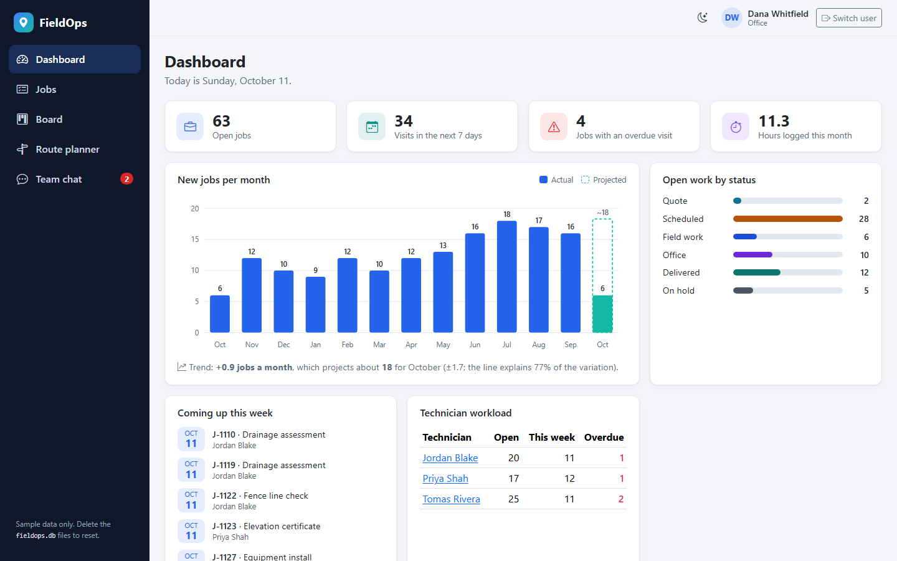
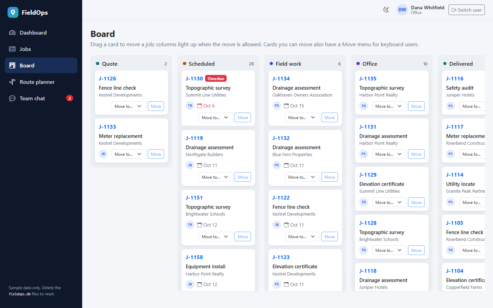
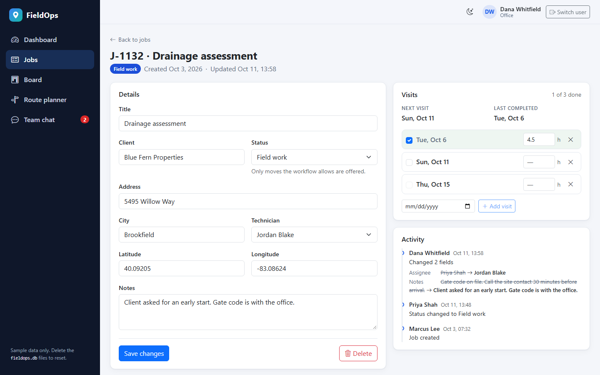
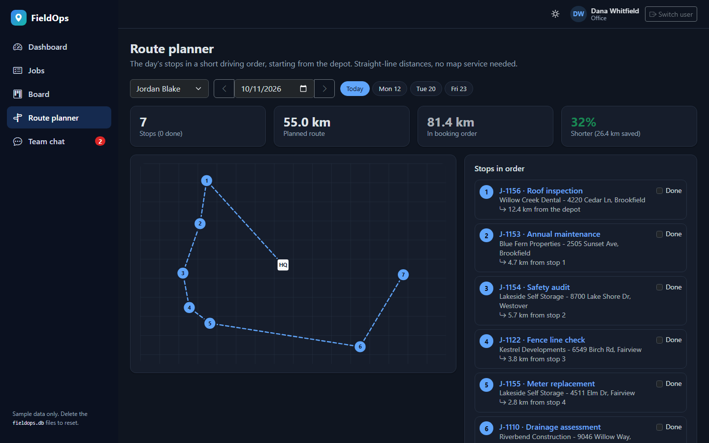

# FieldOps

A small field-service job tracker. The office quotes, schedules and invoices jobs; technicians work through
their own jobs, plan the day's route and log their visits; everyone talks in a live team chat.

Built with .NET 10, Blazor Server, ASP.NET Core minimal APIs and Entity Framework Core on SQLite. It runs
locally with generated sample data: no accounts, API keys or external services.



| Board | Job and activity log | Route planner (dark theme) |
|---|---|---|
|  |  |  |

## Run it

You need the [.NET 10 SDK](https://dotnet.microsoft.com/download/dotnet/10.0). From the repository root:

```bash
dotnet build
dotnet run --project src/FieldOps.Web
```

Open **http://localhost:5080** and pick a sample user. There are no passwords.

| Sample user | Role | What they can do |
|---|---|---|
| Dana Whitfield, Marcus Lee | Office | Create, edit, invoice, cancel and delete any job |
| Priya Shah, Tomas Rivera, Jordan Blake | Field technician | See every job; move their own jobs along, log visits and hours, plan their route |

The first run creates a SQLite database in `src/FieldOps.Web` (`fieldops.db` with its `-wal` and `-shm` files)
and fills it with about fourteen months of sample data dated around today. To start again with fresh data,
stop the app and delete those files.

Run the tests with:

```bash
dotnet test
```

## What to try

- **Dashboard** - open jobs, the week's visits, overdue work and hours logged; the first three tiles open the
  matching job list or route. A hand-drawn SVG chart shows monthly intake and a trend forecast, which appears
  only when the fit is good enough.
- **Jobs** - search, filter and sort. Every setting lives in the URL, so leaving a job, refreshing or
  bookmarking returns to the same view. As an office user, open a job, change something and save: the activity
  log records exactly which fields changed.
- **Board** - drag cards between columns. Only moves the status workflow allows are accepted, and invoicing or
  cancelling is left to the office. Cards you can move also have a Move menu for keyboard users.
- **Route planner** - a technician's stops for the day, put into a short driving order and drawn without any
  map service.
- **Team chat** - sign in as two different people (two browsers, or one private window) to watch messages and
  "handled" ticks arrive live.
- **Theme** - the light/dark toggle in the header. The server renders the chosen theme, so pages load without a
  flash.

## How it is built

- **One set of rules.** The status workflow, visit schedule, route planner, trend forecast and audit diff live in
  `FieldOps.Core`, a library with no dependencies and its own unit tests. The board, the job editor and the API
  all ask the same workflow, so the UI only offers moves the server will accept.
- **Results, not exceptions.** Services report "not found", "not allowed", "invalid" and "changed by someone
  else" as values. The UI shows the message; the API maps it to 404, 403, 400 or 409.
- **No lost updates.** Job edits use optimistic concurrency. Saving over someone else's change is refused, and
  the editor offers to load their version.
- **Audited.** Every change writes its activity-log entry in the same save as the change itself.
- **Live updates.** Chat messages, read state and who is online reach every open browser through the Blazor
  Server connection, with no polling.
- **Routing without a map service.** Stops are ordered with nearest neighbour plus 2-opt on straight-line
  distances, never longer than the order they were booked in, and drawn as SVG.
- **A forecast that knows its limits.** The intake trend is a least-squares line that refuses to project from
  fewer than twelve months, or when it explains less than 20% of the variation.
- **Accessible.** A keyboard Move menu on the board, a skip link, visible focus, a data table behind the chart
  for screen readers, and colours checked for contrast in both themes.

## REST API

A small API under `/api/jobs` uses the same sign-in cookie and the same service as the UI. Sign in in the
browser, then open `http://localhost:5080/api/jobs` in the same browser. Signed-out calls get `401`, not a
redirect.

| Method | Path | Notes |
|---|---|---|
| `GET` | `/api/jobs` | Takes the list's filters, e.g. `?status=Scheduled&open=true&page=2` |
| `GET` | `/api/jobs/{id}` | One job with its visits and activity log |
| `PATCH` | `/api/jobs/{id}/status` | Body `{ "status": "FieldWork" }`; same rules as the board |

Missing jobs and refused changes come back as `application/problem+json` bodies that include a `traceId`.

## Where things are

| Path | What it holds |
|---|---|
| `src/FieldOps.Core` | Domain rules with no dependencies: status workflow, visit schedule, route planner, trend forecast, field-level diff |
| `src/FieldOps.Web/Services` | Application services: permissions, validation, activity log, optimistic concurrency, chat and presence |
| `src/FieldOps.Web/Components` | Blazor UI: pages, layout, and the SVG chart and route map |
| `src/FieldOps.Web/Endpoints` | Sign-in endpoints and the REST API |
| `src/FieldOps.Web/Data` | EF Core model, SQLite context and the sample-data generator |
| `tests/FieldOps.Core.Tests` | Unit tests for the domain rules |
| `tests/FieldOps.Web.Tests` | Service tests for permissions, concurrency, the activity log and validation, on an in-memory SQLite database |

## Security notes

- It runs on `http://localhost:5080` only, over plain HTTP, and the sign-in is password-less on purpose: this is
  a local demo, not a deployment.
- Enforced on the server: role and assignment checks inside the services, antiforgery tokens on form posts,
  local-only return URLs, EF Core parameterised queries, security headers and an enforced Content-Security-Policy.
- A real deployment would add HTTPS with HSTS, ASP.NET Core Identity with lockout, rate limiting and Secure cookies.

## Notes

- Sign-in is a demo shortcut: picking a user issues a cookie for that user. A real deployment would use
  ASP.NET Core Identity or an external identity provider.
- All names, clients and addresses are generated sample data.
